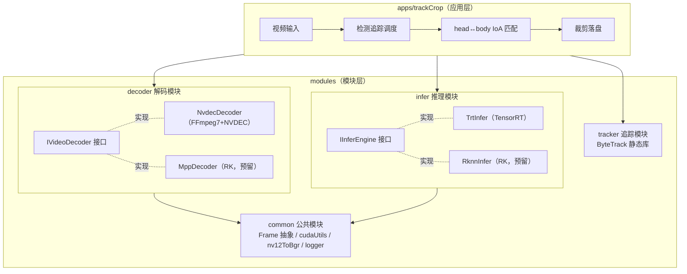
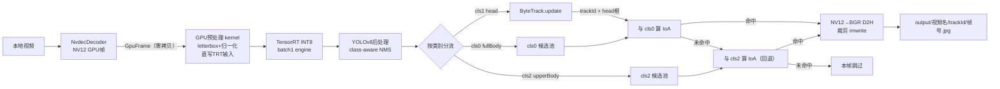
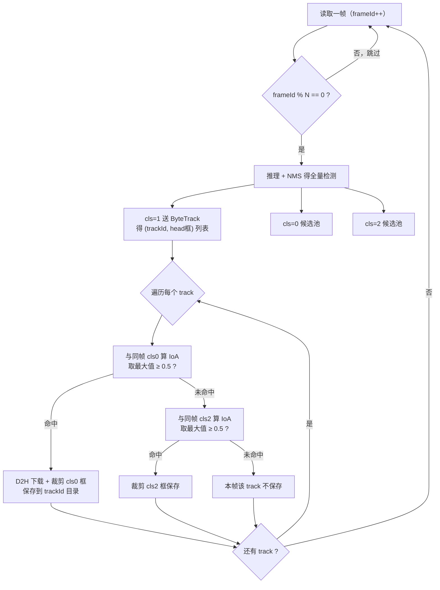
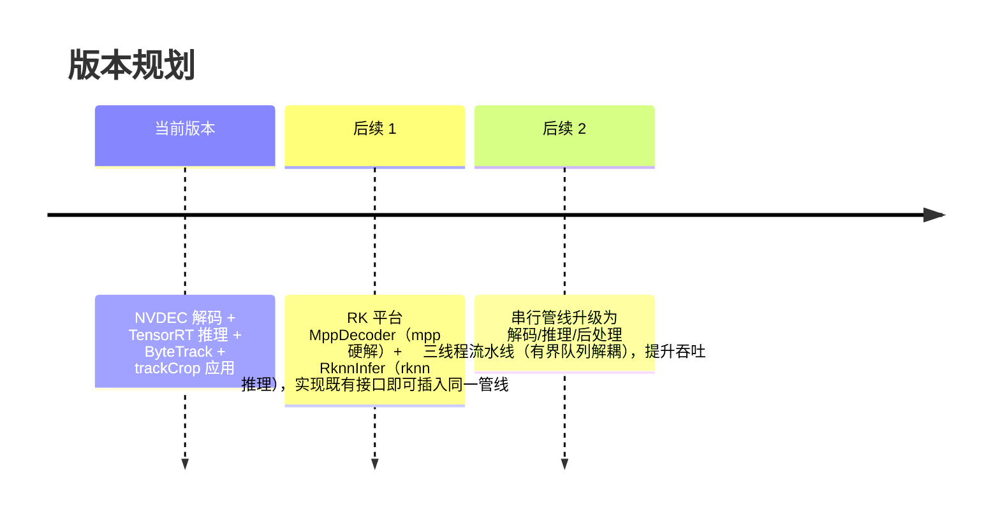

# objectionTrackingACC

模块化 **视频硬解码 + YOLO TensorRT 推理 + ByteTrack 目标追踪** 加速套件（C++17 / CUDA）。

当前版本链路：**NVDEC GPU 解码 → 零拷贝 GPU 预处理 → TensorRT INT8 推理 → ByteTrack 追踪 → 目标裁剪保存**。

解码与推理均以接口隔离，后续接入 RK 平台（mpp 硬解码 / rknn 推理）只需新增接口实现，应用层零改动。

> 方案设计与实施计划详见 [docs/plan.md](docs/plan.md)。

---

## 特性

- **GPU 硬解码**：FFmpeg7 + NVDEC，NV12 帧驻留显存
- **零拷贝推理**：GPU 预处理 kernel 直接写入 TensorRT input buffer，无 D2H/H2D 往返
- **ByteTrack 追踪**：C++ 实现，高/低分两段匹配，参数 yaml 可调
- **head→body 归属匹配**：人头轨迹通过 IoA 包含度匹配全身/半身框，按 ID 归档裁剪图
- **平台可扩展**：`Frame` 抽象 + 解码/推理接口，预留 RK（mpp / rknn）实现位

---

## 系统架构



## 数据流



## trackCrop 应用逻辑



> **匹配规则**：`IoA(head, body) = area(head ∩ body) / area(head)`。head 框通常完整落在人体框内，标准 IOU 区分度差，故采用包含度。
> **多对一冲突**：不同 track 命中同一 body 框时**允许共享**（同一 body 会保存到多个 trackId 目录）。
> **裁剪边界**：匹配框 clamp 到显示宽高内再裁剪；`nv12ToBgr` 使用与解码器一致的 **BT.709 full-range** 矩阵。

---

## 目录结构

```
objectionTrackingACC/
├── CMakeLists.txt
├── README.md                   # 本文档
├── docs/
│   └── plan.md                 # 方案设计与实施计划
├── config/
│   └── tracker.yaml            # ByteTrack 追踪参数
├── modules/
│   ├── common/                 # Frame 抽象 / Detection / cudaUtils / nv12ToBgr / logger
│   ├── decoder/                # IVideoDecoder + NvdecDecoder（预留 MppDecoder）
│   ├── infer/                  # IInferEngine + TrtInfer + gpuPreprocess + postProcessor（预留 RknnInfer）
│   └── tracker/                # ByteTrack 静态库（源自 trackers_cpp）
└── apps/
    └── trackCrop/              # 应用：视频 → 检测追踪 → 按 ID 裁剪归档
```

## 构建

依赖（本机已就绪，CMake 直接链接）：

| 依赖 | 路径 | 用途 |
|---|---|---|
| CUDA 12.6 | `/usr/local/cuda-12.6` | 预处理 kernel / D2H / TRT runtime |
| TensorRT 10.7 | `/home/Disk-6T/tensorrt` | 推理 |
| FFmpeg 7 | `/usr/local/ffmpeg7` | NVDEC 硬解 |
| OpenCV 4.14 | `/home/Disk-6T/opencv/build` | 裁剪 / imwrite（仅 CPU） |
| Eigen3 / yaml-cpp | 系统 | tracker |

```bash
mkdir -p build && cd build
cmake ..
make -j$(nproc)
# 产物：build/bin/trackCrop
```

运行环境：Ubuntu 22.04、NVIDIA 驱动 ≥ 535（对应 CUDA 12.6）、支持 NVDEC 的 NVIDIA GPU。

## 使用

```bash
./build/bin/trackCrop \
    --video /path/to/video.mp4 \        # 本地视频文件（不支持 RTSP 流）
    --engine /path/to/batch1.int8.engine \
    --N 1                                # 每 N 帧处理一帧（检测+追踪+保存），可选，默认 1
    --output ./output                    # 输出根目录，可选，默认 ./output
    --conf 0.01                          # 检测预过滤阈值，可选，默认 0.01
    --ioa 0.5                            # head→body IoA 匹配阈值，可选，默认 0.5
    --tracker-config config/tracker.yaml # ByteTrack 参数，可选
    --min-size 70                        # 裁剪框宽/高任一小于该值不保存，0 关闭过滤（默认 70）
    --debug                              # 逐帧调试明细（见下），可选
```

`--debug` 逐帧打印（便于排查检测/追踪问题）：

- **每帧各环节耗时**：`frame N timing: decode=.. infer=.. track=.. save=.. ms`（跳过帧只打 decode）
- **YOLO 检测明细**：每条 `det[i]: cls=.. conf=.. xyxy=(..)` 及 heads/cls0/cls2 分流统计
- **追踪代价明细**（由 BYTETracker 内部回调输出）：高/低分检测划分、轨迹池构成、三轮匹配的代价矩阵尺寸/匈牙利求解耗时/匹配对数/未匹配数、逐匹配对的 `trackId <- det#i score cost`，以及 activated/refind/lost/removed 状态统计
- **追踪输出与归属**：每个 trackOut（id/score/box）、IoA 命中类别与数值、保存文件名；结束汇总各环节平均耗时

> `--conf` 必须 ≤ tracker.yaml 中的 `track_low_thresh`，否则低分轨迹在预过滤阶段即被丢弃；启动时校验，超限直接报错退出。
>
> 输入支持本地视频文件（mp4/mkv/avi 等封装，编码需 NVDEC 支持：h264/hevc/vp9/av1 等，取决于 GPU 代次）；当前版本不支持网络流。
>
> 色彩格式：要求 NV12 + BT.709，**full/limited 量程均支持**（预处理与 nv12ToBgr kernel 按帧自适应换算）；元数据 unspecified 时按行业惯例回退 limited + BT.709 并打 WARN；明确标记非 BT.709（如 BT.601）报错退出。

输出结构（ID 由 ByteTrack 分配，通常从 1 起；帧号为原始解码帧序号 6 位补零；类别为匹配命中的 body 框 classId，`cls0=fullBody`、`cls2=upperBody`；裁剪图以 **PNG 无损**保存）：

```
output/<视频名（不含扩展名）>/
├── 3810_125502_1/
│   ├── 000012_cls0.png        # 命中 fullBody 裁剪图（无损）
│   └── 000045_cls2.png        # 同一 track 在另一帧回退命中 upperBody
├── 3810_125502_2/
└── 3810_125502_3/
```

> trackId 子目录名以**视频名**为前缀拼接（便于多视频产物同目录区分）；图片名由 **帧号 + 类别** 构成：`%06d_cls<classId>.png`。
>
> ⚠️ 重复运行同一视频会**直接覆盖**同名输出文件，请提前备份或更换 `--output`。

引擎说明：`batch1.int8.engine` 由 performanceAnalysis 项目从 `best.onnx` 经 trtexec INT8 量化构建（类别定义见其 `models/best.metadata.json`），本项目不重复构建，直接使用现成 engine 文件。

模型类别约定（`batch1.int8.engine`）：`0 = fullBody（全身）`，`1 = head（人头，送追踪）`，`2 = upperBody（半身，回退）`。

---

## 扩展路线


