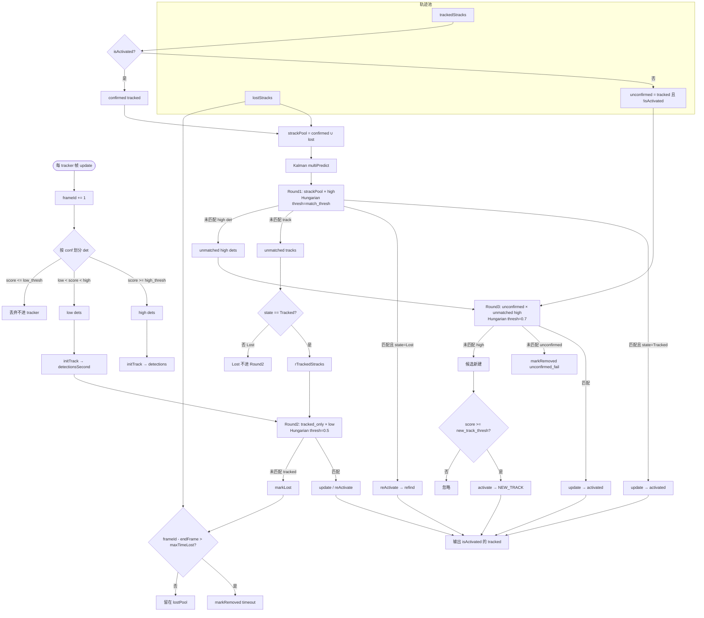
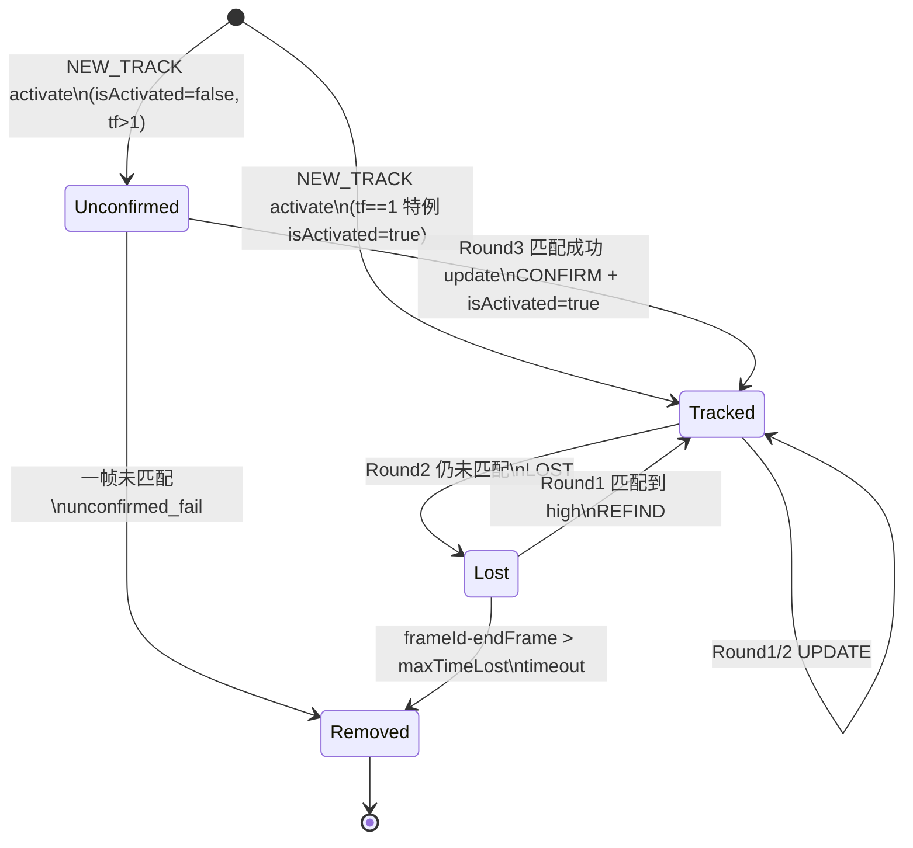
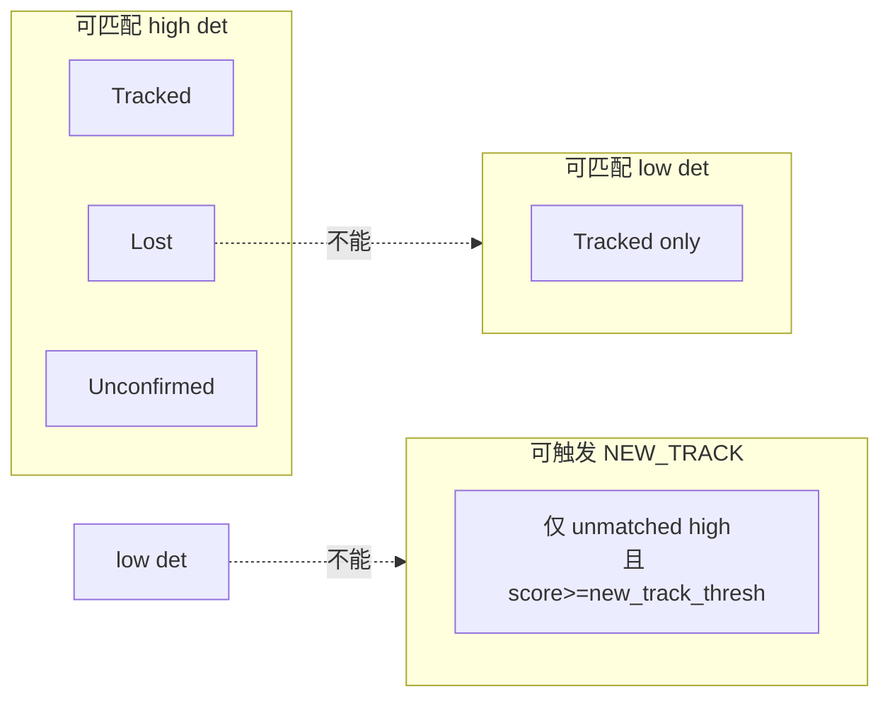
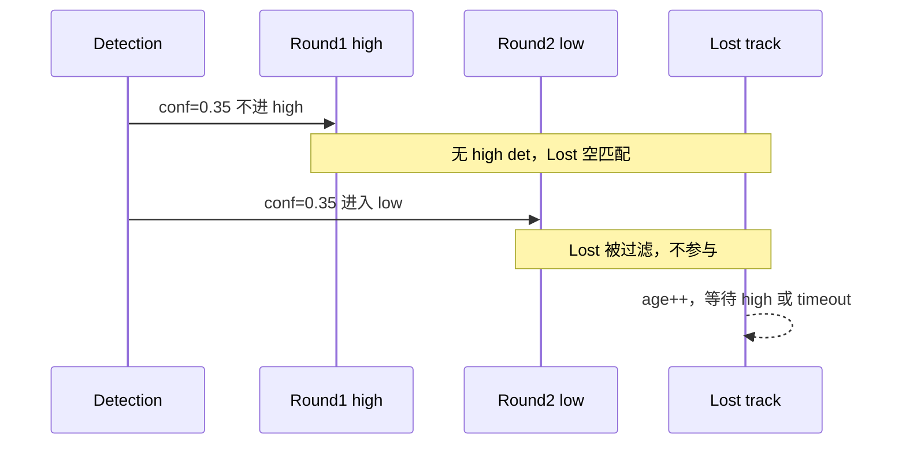

'''
Author: wilbur
Version: 1.1
Date: 2026-08-06
Description: Track ID 断裂修复方案：
  (1) maxTimeLost 时间语义按启动跳帧参数 N 修复；
  (2) debug 日志 P0~P2 全量增强（track 级状态机事件 + 未匹配 cost + 同人多 ID 启发式）；
  (3) ByteTrack 策略分析（mermaid + 推演例子，仅供决策，本阶段不改策略）。
  1.1: 对照源码自审修订——补充 isActivated/frameId==1 特例、resultsToMatrix 过滤 unconfirmed、
       update 签名兼容方案、N 与 maxTimeLost 关系表述、pi 外部审核失败说明与自审结论。
'''

# Track ID 断裂修复与 Debug 全量增强方案

- Author: wilbur
- Version: 1.1
- Date: 2026-08-06
- Status: **自审有条件通过 / 待用户确认公式与策略后实施**
- 审核说明: 按 AGENTS.md 应用 `pi -p` 外部审核时，可用 provider（deepseek/glm/kimi/openai-codex/google）
  均鉴权失败或超时；已改为**对照 modules/tracker 源码人工自审**，结论见 §11，并已并入本文 1.1 修订。

---

## 0. 范围与边界

### 0.1 本方案**要做**的

| 方向 | 内容 |
|---|---|
| **方向 A** | 修复 `maxTimeLost` 时间语义：以启动时传入的跳帧参数 `N` 为准 |
| **方向 B** | Debug 打印 **P0 + P1 + P2 全部落地**（信息越多越好，仅 debug 路径） |

### 0.2 本方案**不做**的（等你看完第 4 节再定）

- 不改 ByteTrack 三轮匹配协议（Lost 是否吃 low、unconfirmed 连帧、ReID 等）
- 不改检测模型 / 阈值默认值（可另开任务）
- 不改 crop / IoA 业务逻辑

### 0.3 成功标准

1. 启动日志能读出：`N / video_fps / tracker_frameRate / track_buffer / maxTimeLost / 各阈值`
2. `N=5, fps=25, track_buffer=5` 时，`maxTimeLost >= 1`（目标按下方公式应为 **5**，见 2.3）
3. 任意 track 的 birth → update → lost → refind/remove 全程可在 log 用 `trackId` 串起来
4. 未匹配时能看到 predicted box、top-1 cost/IoU、失败原因枚举
5. 能自动打出 `ID_BREAK` / `ID_SWAP` 启发式事件，辅助“同人多 ID / 串人”排查
6. **非 debug 路径行为与性能不变**（debug 回调空时零额外热路径分配，尽量）

---

## 1. 问题回顾（为何要修）

### 1.1 现象

同一个人被拆成多个 ID：`1 → 12 → 14 → 29 → 37 → 51 → 68 ...`  
全视频 335 个 trackId，其中 ≤5 次输出的短 track 160 个。

### 1.2 已证实因果链

```text
检测 conf 抖动 / 短暂 heads=0
  → track 进入 Lost
  → maxTimeLost 被算成 0 → 下一帧立刻 Removed（ID 永久死亡）
  → 低分 head 既不能救 Lost，也不能建新 track
  → conf ≥ high_thresh 时发新 ID
  → 同人多 ID
```

### 1.3 当前 maxTimeLost 算错的根因

`apps/trackCrop/trackCropMain.cpp`：

```cpp
cfg.frameRate = max(1, lround(decoder.fps() / args.n));  // 25/5 → 5
BYTETracker tracker(cfg, cfg.frameRate);
```

`modules/tracker/src/byteTracker.cpp`：

```cpp
maxTimeLost = static_cast<int>(frameRate / 30.0 * args.trackBuffer);
// = int(5 / 30.0 * 5) = int(0.833) = 0   ← 致命
```

设计本意（ByteTrack 原版）：`maxTimeLost ≈ 在 30fps 下 buffer 帧数对应的“时间窗口”`，再按实际帧率缩放。  
但本项目是 **每 N 帧处理 1 帧**，tracker 的一“帧”已经代表 N 个视频帧的时间；再除以 30 会把 buffer 压扁到 0。

---

## 2. 方向 A：maxTimeLost 时间语义修复

### 2.1 设计原则

> **以启动时传入的跳帧参数 `N` 为准**，让 `track_buffer` 的语义变为：  
> **“允许连续丢失多少个 tracker 处理帧（即多少个抽帧点）”**。

不再用“假装 30fps 再缩放”的隐式公式，避免抽帧后 int 截断为 0。

### 2.2 时间语义定义（统一口径）

| 符号 | 含义 |
|---|---|
| `video_fps` | 解码器原始帧率（如 25） |
| `N` | 跳帧参数：每 N 个视频帧处理 1 帧（`frameId % N == 0`） |
| `tracker_frameRate` | 有效处理帧率 = `video_fps / N`（如 5） |
| `track_buffer` | yaml 配置，**按 tracker 帧计数**的丢失容忍窗口（默认 5） |
| `maxTimeLost` | 实际使用的丢失容忍 = **f(N, track_buffer, …)**，单位：**tracker 帧** |

删除条件保持 ByteTrack 原逻辑：

```cpp
if (frameId - track->endFrame() > maxTimeLost) markRemoved();
```

因此 `maxTimeLost=5` 表示：末次更新后再过 **5 个 tracker 帧** 仍未匹配 → remove。  
对应真实时间约：`5 * (N / video_fps)` 秒（N=5,fps=25 时约 1.0s）。

### 2.3 推荐公式（选定方案）

```text
maxTimeLost = max(1, track_buffer)   // 单位：tracker 处理帧（每个处理帧对应 N 个视频帧）
```

**理由：**

1. 用户明确要求：**以启动跳帧参数 N 为准**。含义是——tracker 的时间轴已经按抽帧步进（1 tf = N vf），因此 `track_buffer` 应按 **tracker 帧** 计数，而不是再拿 `fps/N` 去除以 30 做二次缩放。
2. 避免 `frameRate/30*buffer` 在低有效帧率下截断为 0。
3. `max(1, …)` 保底：任何配置下至少容忍 1 个 tracker 帧的丢失（防止 yaml 误配 0）。

**“以 N 为准”的精确含义（避免误解）：**

| 层面 | N 是否进入公式 | 说明 |
|---|---|---|
| `maxTimeLost` 整型（tracker 帧） | **不乘 N** | 等于 `max(1, track_buffer)` |
| 真实时间窗口 | **乘 N** | `seconds = maxTimeLost * N / video_fps` |
| 构造 API | **必须传入 N** | 用于日志、CSV、ID_BREAK 的 vf 换算，并防止以后误用 frameRate/30 |

- 构造 tracker 时 **必须传入 N**（或等价的 `skip`），启动日志打印：
  - `maxTimeLost_tracker_frames = max(1, track_buffer)`
  - `maxTimeLost_video_frames  = maxTimeLost * N`
  - `maxTimeLost_seconds       = maxTimeLost * N / video_fps`
- `cfg.frameRate` 仍设为 `video_fps/N`（给日志/将来扩展用），但 **不再参与 maxTimeLost 除 30 缩放**。
- **禁止**再写回 `int(frameRate/30*buffer)`；若未来要“按秒配置 buffer”，应新增 `track_buffer_sec` 字段，而不是复用错误公式。

### 2.4 备选公式（记录，默认不采用）

| 方案 | 公式 | 说明 |
|---|---|---|
| A（采用） | `max(1, track_buffer)` | 最简，N 只影响真实时间换算与日志 |
| B | `max(1, track_buffer * N / refN)` | 若希望 buffer 相对“某参考抽帧”缩放，复杂度高 |
| C | `max(1, round(track_buffer * frameRate / 30))` | 接近原版，但在 frameRate=5 时仍可能偏小（round(0.83)=1） |

> 若审核或用户更倾向 C，可改为 C，但必须保证 `>=1` 且启动日志打印最终值。

### 2.5 代码改动点（方向 A）

#### A1. `BYTETracker` 构造：显式接收跳帧 N，重算 maxTimeLost

**文件：**
- `modules/tracker/include/byteTracker.h`
- `modules/tracker/src/byteTracker.cpp`

**建议接口（保持兼容）：**

```cpp
// 推荐路径：frameRate = video_fps/N（日志用），skipN = 启动跳帧参数
explicit BYTETracker(const TrackerConfig& args, int frameRate, int skipN);

// 旧两参构造保留为委托构造：
// BYTETracker(args, frameRate) : BYTETracker(args, frameRate, /*skipN=*/1) {}
```

**成员新增（便于 debug）：**

```cpp
int skipN = 1;           // 跳帧参数 N（来自应用层 args.n）
int maxTimeLost = 1;     // tracker 帧
int trackerFrameRate = 30; // 保存构造时的 frameRate，仅日志
// getter：maxTimeLostValue() / skipNValue() / trackerFrameRateValue()
// 注意：成员名 maxTimeLost 已存在，getter 勿与成员同名冲突
```

**构造体核心：**

```cpp
skipN = std::max(1, skipNValue);
trackerFrameRate = std::max(1, frameRate);
maxTimeLost = std::max(1, args.trackBuffer);
// 删除：static_cast<int>(frameRate / 30.0 * args.trackBuffer)
```

#### A2. `trackCropMain` 构造时传入 N

**文件：** `apps/trackCrop/trackCropMain.cpp`

```cpp
cfg.frameRate = std::max(1, static_cast<int>(std::lround(decoder.fps() / args.n)));
trackerCpp::BYTETracker tracker(cfg, cfg.frameRate, args.n);  // 传入 N
```

#### A3. 启动时打印时间语义（与 P0 合并）

见方向 B 的 P0-1。

#### A4. 配置注释同步

**文件：** `config/tracker.yaml`、`trackerConfig.h`

- `track_buffer` 注释改为：  
  **“轨迹丢失后允许保留的 tracker 处理帧数（与跳帧 N 无关的计数；真实时间 ≈ buffer * N / video_fps）”**
- `frame_rate` 注释标明：可被应用层按 `fps/N` 覆盖，**不再用于 maxTimeLost 的 /30 缩放**。

### 2.6 方向 A 验证清单

| # | 验证项 | 期望 |
|---|---|---|
| V-A1 | 启动 log 含 `maxTimeLost=5`（默认 buffer=5） | 非 0 |
| V-A2 | 复现 track1 场景：单帧 heads=0 | track 进入 Lost，**不会在下一帧立刻 timeout remove**（除非连续丢失 > maxTimeLost） |
| V-A3 | 人为连续丢检 `maxTimeLost+1` 个 tracker 帧 | 出现 `REMOVE reason=timeout` |
| V-A4 | `N=1` 与 `N=5` 均 `maxTimeLost=track_buffer` | 仅真实秒数不同 |
| V-A5 | 非 debug 跑通原视频 | 无崩溃；ID 碎片化应**明显少于**修前（不要求完美，策略未改） |

---

## 3. 方向 B：Debug 全量增强（P0 + P1 + P2）

### 3.1 总原则

1. **仅 `debugCallback` 非空 / `--debug` 时输出**，release 热路径不刷屏。
2. **统一字段**：每条关键日志尽量带 `vf=`（视频帧）+ `tf=`（tracker 帧）+ `trackId=`。
3. **原因枚举字符串固定**，便于 `rg` / 脚本聚合。
4. **信息宁多勿少**：匹配成功、失败、状态迁移、池快照、启发式断 ID 全打。
5. 应用层（`trackCropMain`）负责 `vf`；tracker 层负责 `tf` 与状态机；必要时 callback 带前缀。

### 3.2 日志前缀约定

```text
[DEBUG] tracker init: ...
[DEBUG] tracker tf=114 vf=565 EVT LOST id=1 reason=no_det ...
[DEBUG] tracker tf=115 vf=570 EVT REMOVE id=1 reason=timeout age=1 maxTimeLost=5 ...
[DEBUG] tracker tf=141 vf=700 EVT NEW_TRACK id=12 from det#0 score=0.8234 box=...
[DEBUG] tracker tf=142 vf=705 EVT CONFIRM id=12 ...   # unconfirmed→activated 可选
[DEBUG] frame 705 ID_BREAK prev_id=1 new_id=12 iou=0.91 dt_tf=27 ...
```

> `vf` 若 tracker 内未知：由 `trackCropMain` 在 `update` 前后注入，或扩展 `update(..., videoFrameId)`。  
> **推荐**：`BYTETracker::update` 增加可选参数 `int64_t videoFrameId = -1`，debug 时写入成员 `lastVideoFrameId`，事件日志统一带上。

---

### 3.3 P0 — 必须（track 级可串联）

#### P0-1. 启动参数一次打印

**位置：** `trackCropMain` tracker 构造后 + `BYTETracker` 构造内各打一次（双保险）

```text
[DEBUG] tracker init: N=5 video_fps=25.000 tracker_frameRate=5 track_buffer=5
        maxTimeLost=5 (video_frames=25, seconds=1.000)
        high=0.6 low=0.04 new=0.2 match=0.9 fuse_score=0 mot20=0
        aspect_ratio_thresh=1.5 min_box_area=10
```

#### P0-2. Track 状态变迁事件（核心）

每条事件 **一行一个 trackId**，字段完整：

| 事件 | 触发点 | 必选字段 |
|---|---|---|
| `NEW_TRACK` | `STrack::activate` 成功 | id, vf, tf, det_idx, score, box, cls, isActivated |
| `CONFIRM` | unconfirmed 经 `update` 后 `isActivated` 从 false→true | id, vf, tf, score, box, round |
| `UPDATE` | 已激活 track 的 `update` 成功（round1/2/3） | id, vf, tf, round, det_idx, score, cost, iou, box |
| `LOST` | `markLost` | id, vf, tf, reason=`no_match`\|`no_det`, last_box, pred_box, last_score |
| `REFIND` | `reActivate` | id, vf, tf, lost_age, det_idx, score, cost, iou, box |
| `REMOVE` | `markRemoved` | id, vf, tf, reason, age, maxTimeLost, last_box, last_score |

**与源码一致的激活特例（实施时必须遵守）：**

```cpp
// STrack::activate
if (frameIdValue == 1) {
    isActivated = true;   // 视频处理的第一个 tracker 帧：新建即激活，无 Unconfirmed 阶段
}
// 否则 isActivated 保持 false → 进 unconfirmed，需再匹配一次才输出/确认
```

- `resultsToMatrix` **过滤 `!isActivated`**：因此 `NEW_TRACK` 后若仍 unconfirmed，**当帧 trackOut 看不到该 id**（与现 log 中 680 有 activated=1 但无 trackOut、705 才出现 id=12 一致）。
- Debug 必须打 `NEW_TRACK`，即使 trackOut 为空，否则会误判“没建轨”。
- `CONFIRM`：仅当 `isActivated` 边沿 false→true 时打；`frameId==1` 的 NEW_TRACK 可带 `isActivated=1`，无需再打 CONFIRM。

**REMOVE reason 枚举：**

| reason | 含义 |
|---|---|
| `timeout` | `frameId - endFrame() > maxTimeLost` |
| `unconfirmed_fail` | round3 未匹配 unconfirmed |
| `dup` | removeDuplicateStracks 剔除（若可区分） |
| `other` | 兜底 |

**LOST reason 枚举：**

| reason | 含义 |
|---|---|
| `no_det` | 本帧 tracker 输入 dets=0（或 high+low 皆空且未匹配） |
| `no_match` | 有 det 但 round1/2 均未匹配上 |

#### P0-3. 每帧 lostPool / tracked 快照（debug）

每帧 summary 后追加明细：

```text
[DEBUG] tracker tf=115 vf=570 pool_detail: tracked=[] lost=[id=1 end_tf=114 age=1 pred=(297,0,364,42)] unconfirmed=[]
[DEBUG] tracker tf=115 vf=570 summary: activated=0 refind=0 lost=0 removed=1 | tracked=0 lostPool=1
[DEBUG] tracker tf=115 vf=570 removed_detail: id=1 reason=timeout age=1 maxTimeLost=5
```

#### P0-4. 新建 / 激活显式日志

禁止只靠 `summary: activated=1` 猜 ID：

```text
[DEBUG] tracker tf=141 vf=700 EVT NEW_TRACK id=12 from det#0 score=0.8234 box=(301.9,3.5,362.7,42.7)
```

#### P0-5. video_frame ↔ tracker_frame 绑定

当前签名：

```cpp
Eigen::MatrixXf update(const DetectionResults& results,
                       const Eigen::MatrixXd* img = nullptr,
                       const Eigen::MatrixXd* feats = nullptr);
```

**推荐改法（兼容、不破坏命名实参习惯）：**

```cpp
// 方案 1（推荐）：新增重载，避免在指针后塞 int 导致调用处静默错误
Eigen::MatrixXf update(const DetectionResults& results,
                       int64_t videoFrameId,
                       const Eigen::MatrixXd* img = nullptr,
                       const Eigen::MatrixXd* feats = nullptr);
// 旧三参委托：videoFrameId = -1
```

或方案 2：`setCurrentVideoFrameId(int64_t)` 在 `update` 前由应用层设置（零签名风险，debug 够用）。

- 所有 tracker debug 行带 `tf=` + `vf=`（vf=-1 时打印 `vf=?`）
- `trackCropMain`：`tracker.setCurrentVideoFrameId(frame->frameId); tracker.update(input);`
  或使用新重载 `tracker.update(input, frame->frameId)`

---

### 3.4 P1 — 匹配失败可归因

#### P1-1. 未匹配 track 打印 top-1 候选

round1 / round2 / round3 结束后，对每个 **unmatched track** 与 **unmatched det**：

```text
[DEBUG]   round1 unmatched track id=1 pred=(297.0,0.0,363.6,41.4) top1_det#2 score=0.0636 cost=0.12 iou=0.88 (thresh=0.9) → reject_by_high_gate(det is low)
[DEBUG]   round1 unmatched det#2 score=0.0636 box=... (not in high set)
[DEBUG]   round2 skip lost id=1 (lost tracks excluded from low-det matching by design)
```

要点：
- 即使最终没配上，也算 **最小 cost / 最大 IoU**
- 若 det 不在本轮候选集，明确写 **gate 原因**（low 不进 round1、lost 不进 round2）

#### P1-2. 轮次语义标签

现有 `round1/2/3` 文案改为：

```text
round1 (tracked+lost × high)
round2 (tracked_only × low)    # 明确 lost 不参与
round3 (unconfirmed × unmatched_high)
```

#### P1-3. cost 矩阵摘要（多目标时）

当 `tracks>1 或 dets>1` 时额外打印：

```text
[DEBUG]   round1 cost_matrix 2x2: [[0.11,0.92],[0.88,0.15]]  # 行=track顺序 id 列表
[DEBUG]   round1 track_order=[1,3] det_order=[0,1]
```

单目标 1x1 可只打 match 行（已有），避免刷屏可选：`tracks*dets <= 16` 才打满矩阵，否则只打每行 top2。

#### P1-4. predicted box vs detection box

LOST / unmatched 时打印：

```text
pred_tlbr=... det_tlbr=... iou=... center_dist=...
```

便于判断是“跑飞”还是“分数门控”。

#### P1-5. fuse_score 真实状态

debug 文案与实现一致：
- `fuse_score=true` → `(iouDist+score)`
- `fuse_score=false` → `(iouDist only)`  
避免再出现 log 写 `+score` 实际未 fuse 的误导。

---

### 3.5 P2 — 批量发现“同人多 ID / 串人”

#### P2-1. 近期 removed 缓存（仅 debug）

在 `BYTETracker` 或 `trackCropMain` 维护：

```text
recentRemoved: 环形缓冲最近 R 条（建议 R=64）
  {id, tf_remove, vf_remove, last_box, last_score, reason}
```

#### P2-2. `ID_BREAK` 启发式

`NEW_TRACK` / `CONFIRM` 时，与 recentRemoved 比 IoU：

```text
若 max IoU(new_box, removed_i.box) >= 0.5
且 (tf_new - removed_i.tf) <= ID_BREAK_TF_WINDOW  # 建议 60 tracker 帧
→ 打：
[DEBUG] frame vf ID_BREAK prev_id=1 new_id=12 iou=0.91 dt_tf=27 dt_vf=135
        prev_box=... new_box=... prev_reason=timeout
```

#### P2-3. `ID_SWAP` 启发式（多目标）

同一帧 round1 匹配后，若存在交叉：
- track A 本帧 box 更靠近 track B 上帧 box，且 B 靠近 A  
或 cost 矩阵出现明显交叉匹配

简化版（先做易实现的）：

```text
若两 tracked 的中心距 < T，且本帧匹配 det 的中心相对上帧发生交叉跳跃
→ ID_SWAP warn
```

第一期可只做 **中心距 + IoU 互换检测**，复杂图匹配后续再加。

#### P2-4. 帧级健康度一行

每处理帧（应用层）：

```text
[DEBUG] frame 570 health: heads=1 head_high=0 head_low=1 tracks=0
        orphan_heads=1 (heads with no track) orphan_tracks=0
```

#### P2-5. 可选 CSV 落盘（debug 目录）

路径：`debug/<videoStem>/tracks_lifecycle.csv`

```csv
track_id,birth_vf,birth_tf,death_vf,death_tf,death_reason,num_updates,mean_cx,mean_cy,mean_w,mean_h,max_score,min_score
1,0,1,575,116,timeout,113,300.1,20.2,60.3,40.1,0.870,0.056
12,700,141,725,146,timeout,4,...
```

实现位置：进程结束或每次 REMOVE 时 append。  
**不阻塞主链路**：同步 append 即可（debug only）。

#### P2-6. 汇总统计（跑完视频）

```text
[DEBUG] tracker stats: total_new=335 total_remove=330 total_refind=64
        id_break_events=120 id_swap_events=3
        lost_no_det=18 lost_no_match=... remove_timeout=... remove_unconfirmed=...
```

---

### 3.6 实现分层

| 层级 | 文件 | 职责 |
|---|---|---|
| Tracker 核心 | `byteTracker.cpp/h` | 状态事件、pool_detail、unmatched cost、矩阵摘要、recentRemoved、ID_BREAK/SWAP、stats |
| 应用层 | `trackCropMain.cpp` | 传入 N 与 vf、启动参数打印、health 行、CSV 路径、结束 stats 触发 |
| 配置 | `tracker.yaml` / `trackerConfig.h` | 注释修正；**不新增业务阈值也可**（ID_BREAK 窗口可用常量或后续 yaml） |

### 3.7 Debug 性能约束

- 全量 cost 矩阵仅 debug 且规模受限
- 字符串用 `ostringstream` / 栈上 `snprintf`，避免每 det 多次堆分配（尽量）
- CSV / 长日志仅 `--debug`

---

## 4. Track 策略分析（仅供决策，本阶段不改代码）

> 你要求：先给 mermaid 流程图 + 推演例子，看完再决定是否改策略。  
> 下面描述的是 **当前实现行为**，不是修复后的策略。

### 4.1 当前 ByteTrack 主流程（实现映射）



### 4.2 单条 track 状态机



说明：
- 状态枚举仍是 `Tracked/Lost/Removed`；`Unconfirmed` 是 **Tracked + !isActivated** 的逻辑子状态，不是独立 `TrackState`。
- Lost 的 REFIND 只走 **Round1×high**（当前实现 Round2 池不含 Lost）。

**关键不对称：**



### 4.3 推演例子（结合本视频真实数字）

以下 `tf` = tracker 帧，`vf` = 视频帧，`N=5`。  
**修前** `maxTimeLost=0`；**方向 A 修后** `maxTimeLost=5`（策略仍为当前 ByteTrack）。

---

#### 例子 1：track1 死亡 → track12 重生（已发生）

| 步骤 | vf | tf(约) | head conf | 修前行为 (maxTimeLost=0) | 方向 A 修后 (maxTimeLost=5，策略不变) |
|---|---|---|---|---|---|
| 1 | 560 | 113 | 0.803 high | track1 UPDATE | 同左 |
| 2 | 565 | 114 | heads=0 | track1 **LOST** (endFrame=113) | 同左 |
| 3 | 570 | 115 | 0.064 low | Lost 不进 R2；`115-113>0` → **REMOVE timeout** | Lost 不进 R2；`115-113=2≤5` → **仍留 lostPool** |
| 4 | 575 | 116 | 0.019 <low | pool 已空 | det 不进 low/high；age 继续涨 |
| 5 | 580–675 | 117–136 | 0.05–0.37 low | 无 track；低分不能 NEW | Lost **仍不吃 low**；约 tf119 起 `age>5` → **timeout REMOVE**（仅多续命 ~5 tf ≈1s） |
| 6 | 680 | 137 | 0.626 high | NEW unconfirmed（新 id，**无 trackOut**） | id=1 多半已 timeout；仍 **NEW** 新 id |
| 7 | 685 | 138 | 0.485 low | unconfirmed **REMOVE unconfirmed_fail** | 同左 |
| 8 | 700–705 | 141–142 | 0.82 high×2 | NEW + CONFIRM → **id=12 trackOut** | 同左（长 low 段策略未改则仍断 ID） |

**结论：**  
- 只修 maxTimeLost：只能吃掉 **短漏检**（≤ buffer 个 tf 内 conf 回到 high）。  
- 本 case 低分段远长于 5 tf → **方向 A  alone 救不回 track1→12**，但能救“丢 1–5 个处理帧又出现 high”的大量碎片。  
- 长 low-conf 必须靠策略 Sn（Lost 吃 low / 降 high / 同位置复活等）。

---

#### 例子 2：Lost 面对 low det（协议死角）

```text
状态: id=29 Lost, pred box ≈ (300,1,360,40)
本帧: head conf=0.35, box 几乎重合, IoU=0.9

Round1: det 是 low → 不在 high 集合 → Lost 无候选可配
Round2: 只接受 Tracked → Lost 被排除
结果: 不 REFIND；age++；最终 timeout → 新 ID
```



---

#### 例子 3：Unconfirmed 抖动（出生即死）

```text
vf=680 conf=0.626 → NEW_TRACK id=X (unconfirmed)
vf=685 conf=0.485 → 无 high；Round3 无 det → REMOVE unconfirmed_fail
vf=700 conf=0.823 → NEW_TRACK id=Y
```

人没动，浪费 2 个 ID。`maxTimeLost` **帮不到 unconfirmed**（它不进 lostPool，直接 remove）。

---

#### 例子 4：修后 buffer 如何“续命”成功（理想短漏检）

```text
vf=1000 conf=0.8  → id=51 UPDATE
vf=1005 heads=0   → LOST age 起算
vf=1010 conf=0.75 → Round1 high × Lost → REFIND id=51  ✅
```

修前 maxTimeLost=0：vf=1010 时 id 可能已 remove，只能 NEW。  
修后：短漏检可恢复。

---

#### 例子 5：多目标 IoU 混淆（“追错”另一类）

```text
id=A pred 左, id=B pred 右
两 det 交叉靠近 → Hungarian 可能交换
→ 表现为 ID 粘到另一个人（SWAP），不是 break
```

本方案 P2 `ID_SWAP` 用于发现；**修复 swap 需要策略/特征，不在本阶段**。

---

### 4.4 策略选项菜单（你决定后再开任务）

| 选项 | 改动 | 能解决的例子 | 风险 |
|---|---|---|---|
| S0 只做 A+B | 本方案 | 短漏检 REFIND↑、可分析 | 长 low-conf 仍断 ID |
| S1 Lost 也可匹配 low | Round2 池含 lost | 例子 2 | 低分噪点拉跑 track |
| S2 Unconfirmed 需连续 K 帧 | 出生更稳 | 例子 3 | 短出现目标更慢确认 |
| S3 降低 high_thresh | 更多 high | 真空期缩短 | 假阳增多 |
| S4 同位置短时复活 | remove 后 IoU 复用旧 ID | 例子 1 长 gap | 可能串人 |
| S5 外观 ReID | 特征匹配 | 长遮挡 | 工程量大 |

**请你看完 4.1–4.3 后选择：S0 仅落地 / 或 S0+某 Sn。**

---

## 5. 详细 TODO LIST

### 阶段 0：文档与审核

- [ ] **T0.1** 本方案文档落档：`docs/trackIdBreakFixPlan.md`（本文）
- [ ] **T0.2** `pi -p` 审核本方案，根据结果修订版本号与条目
- [ ] **T0.3** 用户确认：方向 A 公式采用 A（`max(1,track_buffer)`）还是 C
- [ ] **T0.4** 用户确认：策略仅 S0 或附加 S1–S5（**策略代码等确认后再动**）

### 阶段 1：方向 A — maxTimeLost 修复

- [ ] **T1.1** `byteTracker.h`：构造增加 `skipN`；成员 `skipN`；getter（可选）
- [ ] **T1.2** `byteTracker.cpp`：删除 `frameRate/30*buffer`；改为 `maxTimeLost = max(1, args.trackBuffer)`；保存 `skipN`
- [ ] **T1.3** 兼容旧构造：两参时 `skipN=1`，行为与三参一致（仅 N 日志不同）
- [ ] **T1.4** `trackCropMain.cpp`：`BYTETracker(cfg, cfg.frameRate, args.n)`
- [ ] **T1.5** `tracker.yaml` / `trackerConfig.h` 注释更新时间语义
- [ ] **T1.6** `createByteTracker()` 等工厂函数同步（若有）
- [ ] **T1.7** 编译通过；启动 log 检查 maxTimeLost
- [ ] **T1.8** 用同一视频短跑验证：单帧丢检不再瞬间 remove（对照 V-A2/A3）

### 阶段 2：方向 B — P0 Debug

- [ ] **T2.1** `update` 增加 `videoFrameId` 参数并存储
- [ ] **T2.2** 启动 `tracker init` 完整参数行（含 N、maxTimeLost 秒数）
- [ ] **T2.3** 实现 EVT 框架：统一 `emitEvent(type, fields...)`
- [ ] **T2.4** `NEW_TRACK` / `CONFIRM` / `UPDATE` / `LOST` / `REFIND` / `REMOVE` 全埋点
- [ ] **T2.5** `pool_detail` + `removed_detail` 每帧输出
- [ ] **T2.6** `trackCropMain` 传入 `frame->frameId` 作为 vf
- [ ] **T2.7** 用 track1 段 log 人工串读：birth→…→remove 可完整复原

### 阶段 3：方向 B — P1 Debug

- [ ] **T3.1** round 文案改为含集合语义（tracked+lost×high 等）
- [ ] **T3.2** unmatched track/det top-1 cost/iou/gate 原因
- [ ] **T3.3** lost 被排除 round2 的显式一行说明
- [ ] **T3.4** 小规模 cost 矩阵转储 + track_order/det_order
- [ ] **T3.5** pred vs det 几何字段（iou、center_dist）
- [ ] **T3.6** fuse_score 文案与实现一致

### 阶段 4：方向 B — P2 Debug

- [ ] **T4.1** recentRemoved 环形缓冲（R=64）
- [ ] **T4.2** `ID_BREAK` 启发式（IoU≥0.5 且 dt_tf≤60，常量可调）
- [ ] **T4.3** `ID_SWAP` 简化检测（双 track 中心交叉）
- [ ] **T4.4** 应用层 `health` 行（orphan heads/tracks）
- [ ] **T4.5** `debug/<stem>/tracks_lifecycle.csv` 输出
- [ ] **T4.6** 进程结束 `tracker stats` 汇总
- [ ] **T4.7** 全视频重跑，统计 id_break 次数，与修前 335 IDs 对比

### 阶段 5：回归与验收

- [ ] **T5.1** Debug OFF：确认无新增刷屏、功能与修前一致（除 maxTimeLost 行为）
- [ ] **T5.2** Debug ON：抽查 1→12 段，事件齐全
- [ ] **T5.3** 记录修前/修后：unique track 数、ID_BREAK 数、最长 track 寿命
- [ ] **T5.4** 更新 `docs/trackIdBreakFixPlan.md` Version 与实施结果备注
- [ ] **T5.5** （可选）用户确认后另开「策略 Sn」任务文档

---

## 6. 文件改动清单（实施时）

| 文件 | 改动类型 |
|---|---|
| `modules/tracker/include/byteTracker.h` | 构造/成员/update 签名/getter |
| `modules/tracker/src/byteTracker.cpp` | maxTimeLost 公式 + 全量 debug 埋点 |
| `apps/trackCrop/trackCropMain.cpp` | 传 N、传 vf、init/health/CSV/stats |
| `modules/tracker/include/trackerConfig.h` | 注释 |
| `config/tracker.yaml` | 注释 |
| `docs/trackIdBreakFixPlan.md` | 本文；实施中迭代 Version |

**预计不改：** 检测、IoA 匹配、编码器、Kalman 数值本身。

---

## 7. 风险与回滚

| 风险 | 缓解 |
|---|---|
| maxTimeLost 变大后错误 track 残留更久 | 日志可观察；可调 track_buffer；仍无 ReID |
| debug 日志体积暴涨（23MB→更大） | 仅 --debug；矩阵有规模门控；可后续加 --debug-level |
| update 签名变更导致编译失败 | 默认参数 `videoFrameId=-1` 保持兼容 |
| ID_BREAK 误报 | 只打日志不改 ID；阈值保守 |

回滚：git 还原上述文件；yaml 无需数值回滚（只改注释的话）。

---

## 8. 实施顺序建议

```text
T0 审核确认
  → T1 maxTimeLost（小 diff，先修正确性）
  → T2 P0 事件（立刻可分析）
  → T3 P1 匹配细节
  → T4 P2 启发式 + CSV
  → T5 回归对比
  → （用户决策后）策略 Sn
```

---

## 9. 待用户拍板项（汇总）

1. **maxTimeLost 公式**：默认 **方案 A** `max(1, track_buffer)` — 是否同意？
2. **策略**：本阶段是否严格 **S0 only**？（流程图与例子见第 4 节）
3. **ID_BREAK 窗口**：默认 `dt_tf≤60` 且 `IoU≥0.5` — 是否要写进 yaml？（建议先常量）
4. **CSV**：是否必须？还是先 log 事件即可？（建议 P2 做，常量路径 `debug/<stem>/tracks_lifecycle.csv`）
5. **vf 注入方式**：`setCurrentVideoFrameId` vs `update` 重载 — 默认推荐 setter（改动面更小）

---

## 10. 附录：修前关键公式 vs 修后

| 项 | 修前 | 修后（方案 A） |
|---|---|---|
| frameRate 传入 | `fps/N` | 同左（日志用） |
| maxTimeLost | `int(frameRate/30*buffer)` → 常为 0 | `max(1, buffer)` |
| N 的作用 | 只影响 frameRate 间接（错误缩放） | **显式传入**；真实时间 = buffer×N/fps |
| track1 @ vf565 丢检 | 下一帧即可 timeout remove | 最多再等 buffer 个 tracker 帧 |
| 长 low-conf 段 | 必断 ID | **仍可能断 ID**（需策略 Sn） |

---

## 11. 自审结论（源码对照，2026-08-06）

### 11.1 外部 pi 审核状态

`pi -p` 多 provider 鉴权失败/超时，**未取得独立模型书面审核**。以下为对照
`byteTracker.cpp` / `trackCropMain.cpp` / 既有 `debug.log` 的自审。

### 11.2 已发现问题与文档处置

| 等级 | 问题 | 处置 |
|---|---|---|
| High | 原文“以 N 为准”易被读成 `maxTimeLost *= N` | §2.3 改表：N 进真实时间，不进整型 buffer |
| High | 例子 1 暗示修后 570 帧就能靠 buffer 撑到 680 | 已改：仅 +5 tf，长 low 仍断 ID |
| High | 未写清 `activate` 在 `frameId==1` 直接 isActivated | §P0-2 / 状态机已补 |
| High | 未写清 `resultsToMatrix` 过滤 unconfirmed → 无 trackOut | §P0-2 已补 |
| Medium | `update(..., videoFrameId)` 塞在指针后易误用 | 改为推荐 setter 或前置重载 |
| Medium | Round2 的 reActivate 分支在代码存在，但 Lost 进不了 R2 池 | 策略图注明“实际上 Lost 只走 R1” |
| Medium | `dup` remove 是否可区分依赖 `removeDuplicateStracks` 返回路径 | 实施时能区分则打 `dup`，否则 `other` |
| Low | ID_BREAK 窗口未配置化 | 先常量，TODO 已列 |
| Low | 日志体积 | 仅 --debug + 矩阵规模门控 |

### 11.3 策略描述与代码一致性

- Round1：`strackPool = confirmed tracked ∪ lost` × high — **一致**
- Round2：仅 `unmatchedA` 中 `state==Tracked` × low — **一致**（Lost 排除）
- Round3：unconfirmed × unmatched high，thresh 0.7 — **一致**
- NEW：unmatched high 且 `score >= newTrackThresh` — **一致**
- timeout：`frameId - endFrame() > maxTimeLost` — **一致**
- 输出过滤 `!isActivated` — **一致**（文档 1.0 遗漏，1.1 已补）

### 11.4 审核裁定

**有条件通过**，条件：

1. 用户确认公式方案 A（或明确改 C）
2. 本阶段策略范围确认为 S0（或点名附加 Sn）
3. 实施时按 1.1 修订落实 isActivated 特例与 vf 注入方式
4. 不把“只修 maxTimeLost”宣传成能修好 track1→12 整段长 low-conf

满足后可按 §5 TODO 从 T1→T2→T3→T4→T5 执行。
