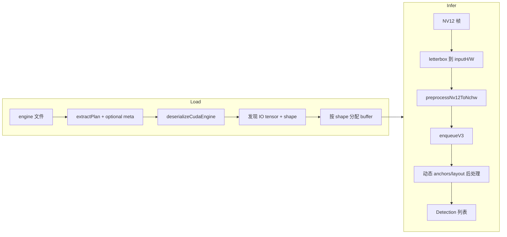

'''
Author: wilbur
Version: 1.0
Date: 2026-08-06
Description: TensorRT engine 兼容与动态 IO shape 修复方案。
  (1) 兼容「元数据头 + 裸 plan」的 engine 封装格式；
  (2) 废除 640/8400 等硬编码，从 engine 实际 input/output shape 驱动预处理与后处理。
'''

# TensorRT Engine 兼容 + 动态输入输出 Shape 修复方案

- Author: wilbur
- Version: 1.0
- Date: 2026-08-06
- Status: **已实施（2026-08-06）**
- 实测：`1batch_3090.engine` → format=meta+plan planOffset=442, input=1280x1280, output=[1,7,34000]；
  `batch1.int8.engine` → raw-plan, input=640x640, output=[1,7,8400]。均 load + infer 正常。
- 触发问题：
  - 加载 `1batch_3090.engine`（1280）失败：`magicTag / incompatible serialization version`
  - 根因已核实：文件前部带 JSON 元数据，裸 TRT plan 从 offset 后才开始；且代码硬编码 640/8400

---

## 0. 范围

### 要做

| 方向 | 内容 |
|---|---|
| **A. Engine 封装兼容** | 识别并剥离元数据头，只把裸 plan 交给 `deserializeCudaEngine`；兼容现有裸 `ftrt` 文件 |
| **B. 动态 IO** | 输入 H/W、输出通道/锚点数、tensor 名从 engine 读取；预处理 letterbox 与后处理按实际 shape 工作 |
| **C. Debug/日志** | 打印 meta（若有）、最终 input/output shape、buffer 字节数、类别数 |

### 不做（本阶段）

- 不改 ByteTrack 策略、不改 crop/IoA 业务
- 不支持 batch>1（应用仍 batch=1）
- 不自动下载/转换 onnx；只消费本机已有 engine
- 不强制支持任意输出布局（见 §3 输出约定）

### 成功标准

1. 旧 `batch1.int8.engine`（裸 plan、640、output `[1,7,8400]`）行为与现网一致  
2. 新 `1batch_3090.engine`（meta+plan、1280）能 load + infer，不因 magicTag 失败  
3. 输入尺寸、输出锚点数**无** `640`/`8400` 硬编码依赖  
4. `--debug` 日志能看到解析后的 shape 与 meta 摘要  
5. 非 debug 路径无额外行为变化（除兼容解析外）

---

## 1. 问题事实（已核实）

### 1.1 文件布局（1280 engine）

```text
offset 0:     uint32_t metaLen = 438   (小端)
offset 4:     JSON 元数据（metaLen 字节）
offset 4+metaLen (=442):  裸 TensorRT plan，magic = "ftrt" ... "rtrt"
```

JSON 摘要：

```json
{
  "imgsz": [1280, 1280],
  "batch": 1,
  "nc": 3,
  "names": { "0": "body", "1": "head", "2": "UpperBody" },
  "stride": 32,
  "task": "detect",
  ...
}
```

可跑的旧 engine 直接以 `ftrt` 开头，无 meta 头。

### 1.2 当前代码硬编码点

| 位置 | 硬编码 | 影响 |
|---|---|---|
| `trtInfer.h` `kInputWidth/Height=640` | 输入尺寸 | 预处理 letterbox、setInputShape、buffer |
| `kAnchorCount=8400` | 输出锚点 | 后处理循环、output buffer |
| `kOutputChannels=7` | 4+3 类 | 后处理布局假设 |
| `kInputName="images"` / `kOutputName="output0"` | 名字 | 找不到则直接 fail |
| `load()` 整文件 deserialize | 无剥离 meta | 1280 封装文件 magic 失败 |
| `setInputShape([1,3,640,640])` | 固定 shape | 1280 engine 即使反序列化成功也会错 |

### 1.3 报错链路

```text
读整个文件 → deserializeCudaEngine(整文件)
  → 文件头不是 plan magic → TensorRT 报 serialization/magicTag 失败
  → 尚未执行 640 校验
```

用户正确判断：**本机可用 engine，只是封装不同；代码需兼容。**  
同时：**尺寸必须从模型读，不能写死。**

---

## 2. 方向 A：Engine 文件解析兼容

### 2.1 支持的两种格式

```mermaid
flowchart TD
    Read[读取 engine 文件 bytes] --> Peek{前 4 字节是否为 ftrt?}
    Peek -->|是| Raw[整文件 = 裸 plan]
    Peek -->|否| MetaTry{解析 u32 metaLen + JSON?}
    MetaTry -->|JSON 合法且后续为 ftrt| Strip[plan = bytes[4+metaLen : ]]
    MetaTry -->|否| Scan[在文件中搜索 ftrt magic]
    Scan -->|找到| Strip2[plan = bytes[ftrt_offset : ]]
    Scan -->|找不到| Fail[报错: unrecognized engine format]
    Raw --> Deser[deserializeCudaEngine plan]
    Strip --> Deser
    Strip2 --> Deser
```

### 2.2 推荐解析算法（确定性、少误判）

```text
function extractPlan(bytes):
  // 1) 裸 plan
  if bytes starts with "ftrt":
    return { plan=bytes, meta=null }

  // 2) [u32le metaLen][json][plan]
  if bytes.size >= 8:
    metaLen = u32le(bytes[0:4])
    if 2 <= metaLen <= min(1<<20, bytes.size-8):
      jsonBytes = bytes[4 : 4+metaLen]
      if isLikelyJsonObject(jsonBytes) and bytes[4+metaLen : 4+metaLen+4] == "ftrt":
        meta = parseJson(jsonBytes)  // 可选，失败则 meta=null 仍可用 plan
        return { plan=bytes[4+metaLen :], meta }

  // 3) 兜底：全文搜 "ftrt"（防止 metaLen 字段变体）
  off = find(bytes, "ftrt")
  if off >= 0 and off + 8 < bytes.size:
    // 若 off 前是 JSON，尝试解析 meta（best-effort）
    return { plan=bytes[off:], meta=bestEffortMeta(bytes[0:off]) }

  throw "unrecognized engine format"
```

`isLikelyJsonObject`：首非空白为 `{`，末非空白为 `}`，且 UTF-8 可解析。

### 2.3 Meta 使用策略

| 字段 | 用途 |
|---|---|
| `imgsz` | **仅日志/校验**；真正输入尺寸以 engine tensor shape 为准 |
| `nc` / `names` | 日志；classId 仍用 0/1/2 数值（与 trackCrop 约定一致） |
| `batch` | 必须为 1，否则明确报错 |

**原则：meta 永不覆盖 engine 真实 shape**，避免 meta 与 plan 不一致时静默错误。

### 2.4 日志（load 时）

```text
[DEBUG] engine file format=meta+plan metaLen=438 planOffset=442 planBytes=...
[DEBUG] engine meta: imgsz=1280x1280 batch=1 nc=3 names={0:body,1:head,2:UpperBody}
[DEBUG] TensorRT runtime version: 10.7.0
[DEBUG] input tensor=images dtype=float shape=[1,3,1280,1280]
[DEBUG] output tensor=output0 dtype=float shape=[1,7,33600]
```

---

## 3. 方向 B：从 Engine 读取 IO，废除硬编码

### 3.1 运行时模型描述

替换 `static constexpr` 为成员（load 后填充）：

```cpp
struct ModelIo {
    std::string inputName;
    std::string outputName;
    int batch = 1;          // 必须 1
    int channels = 3;       // 必须 3
    int inputH = 0;
    int inputW = 0;
    int outChannels = 0;    // 期望 4 + numClasses
    int numAnchors = 0;     // 如 8400 / 33600
    int numClasses = 0;     // outChannels - 4
    nvinfer1::DataType inputDtype = kFLOAT;
    nvinfer1::DataType outputDtype = kFLOAT;
};
```

### 3.2 Tensor 发现（不写死名字优先）

```text
1. 遍历 getNbIOTensors()
2. 按 TensorIOMode 分 INPUT / OUTPUT
3. 输入候选：
   - 优先名 == "images"
   - 否则取第一个 FLOAT 的 4D input（N,C,H,W）
4. 输出候选：
   - 优先名 == "output0"
   - 否则取第一个 FLOAT 的 3D output（N, C, A）或（N, A, C）——见布局
5. 若 input/output 均唯一，直接采用；若多个则按名字优先 + 日志列出全部
```

### 3.3 Shape 解析规则

#### 输入

- 期望 rank=4：`[N, C, H, W]`
- `N` 固定为 1（若 engine 为 -1 动态，则 `setInputShape` 为 1）
- `C` 必须为 3
- `H,W`：若为确定值则直接用；若为 -1，则：
  1. 尝试 meta.imgsz
  2. 否则报错要求固定 shape engine 或提供配置（本阶段不引新 CLI，优先要求 engine 固定）

#### 输出（YOLOv8 detect 导出常见）

两种布局都要识别：

| 布局 | shape | 后处理索引 |
|---|---|---|
| **A（当前代码）** | `[1, 4+nc, anchors]` | `frameOut[ch * anchors + a]` |
| **B（部分导出）** | `[1, anchors, 4+nc]` | `frameOut[a * (4+nc) + ch]` |

判定：

```text
if dims == [1, C, A] and C < A:  layout=A, outChannels=C, anchors=A
if dims == [1, A, C] and C < A:  layout=B, outChannels=C, anchors=A
if C == 4+nc 不成立: 报错
numClasses = outChannels - 4
要求 numClasses >= 1（本项目期望 3，但允许 >=1 并 warn if !=3）
```

**1280 非 P6 预期**：`anchors = 160²+80²+40² = 33600`，`C=7` → `[1,7,33600]` 布局 A。

### 3.4 setInputShape / buffer

```text
inputDims = [1, 3, inputH, inputW]
setInputShape(inputName, inputDims)
// 再读 output shape（动态输出时依赖 input）
outDims = getTensorShape(outputName)
解析 layout / anchors / classes
inputBytes  = 1*3*H*W*sizeof(float)
outputBytes = product(outDims)*sizeof(element)
allocate 并 setTensorAddress
```

### 3.5 预处理

```text
// 旧：computeLetterboxParams(..., 640, 640)
// 新：
lb = computeLetterboxParams(frameW, frameH, model.inputW, model.inputH)
preprocessNv12ToNchw(..., model.inputW, model.inputH, lb, ...)
```

`gpuPreprocess` **已按参数收 H/W**，无需改 CUDA 接口，只需调用处传动态值。

### 3.6 后处理

```text
for a in [0, numAnchors):
  按 layout A/B 取 cx,cy,w,h 与各类 score
  bestClass / bestScore
  conf 过滤
  letterbox 逆映射（用 lb，已含正确 pad/scale）
class-aware NMS 不变
```

**类别约定（与 trackCrop 对齐）**：

| classId | 业务 |
|---|---|
| 0 | fullBody / body |
| 1 | head |
| 2 | upperBody |

若 meta.names 顺序不同，**本阶段仍以导出 channel 顺序为准**；若未来 names 乱序，再加 mapping 表。当前 1280 meta 已是 0=body,1=head,2=UpperBody，与现网一致。

### 3.7 删除/降级的常量

| 旧常量 | 处理 |
|---|---|
| `kInputWidth/Height` | 改为成员 `inputW_/inputH_` |
| `kAnchorCount` | 改为 `numAnchors_` |
| `kOutputChannels` | 改为 `outChannels_` |
| `kClassCount=3` | 改为 `numClasses_`，`!=3` 时 `logWarn` |
| `kInputName/kOutputName` | 改为成员字符串，默认仍优先匹配这两个名字 |

---

## 4. 架构改动图



---

## 5. 文件改动清单

| 文件 | 改动 |
|---|---|
| `modules/infer/trtInfer.h` | 去掉 640/8400 常量；增加 `ModelIo` 成员、format 解析声明 |
| `modules/infer/trtInfer.cpp` | extractPlan、discoverIo、动态 load/infer/postProcess |
| `modules/infer/gpuPreprocess.*` | **原则上不改**（已参数化） |
| `apps/trackCrop/trackCropMain.cpp` | 无业务改动；依赖 TrtInfer 接口不变 |
| `docs/trtEngineCompatPlan.md` | 本文 |

可选：若不想在 cpp 里手写 JSON，用极简扫描解析 `imgsz`/`nc`（或只做日志用的正则），**不强制引入 nlohmann/json**。

---

## 6. 详细 TODO LIST

### 阶段 0：方案确认

- [ ] **T0.1** 用户确认本方案（格式兼容 + 动态 shape）
- [ ] **T0.2** 确认 1280 输出布局是否为 `[1,7,33600]`（实施时用 load 日志验证；代码兼容 A/B）
- [ ] **T0.3** （可选）`pi -p` 审核本文

### 阶段 1：Engine 封装兼容

- [ ] **T1.1** 实现 `extractEnginePlan(bytes) -> {planOffset, planSize, metaJson optional}`
- [ ] **T1.2** 单元式手工验证：  
  - 裸 `batch1.int8.engine` → planOffset=0  
  - `1batch_3090.engine` → planOffset=442  
- [ ] **T1.3** `deserializeCudaEngine(planPtr, planSize)` 两文件均成功
- [ ] **T1.4** 失败时错误信息区分：`format` / `deserialize` / `no input`

### 阶段 2：动态 IO 发现与 load

- [ ] **T2.1** 遍历 IO tensors，解析 input/output 名与 dtype
- [ ] **T2.2** 解析 input `[1,3,H,W]`，填充 `inputH_/inputW_`
- [ ] **T2.3** `setInputShape` 使用动态 H/W；动态维处理策略按 §3.3
- [ ] **T2.4** 解析 output layout A/B，填充 `numAnchors_/outChannels_/numClasses_/layout_`
- [ ] **T2.5** 按真实字节数分配 input/output/host buffer
- [ ] **T2.6** 删除对 `expected=[1,7,8400]` 的硬失败；改为校验「可识别 YOLO detect 布局」
- [ ] **T2.7** load 日志打印完整 ModelIo + meta

### 阶段 3：infer / postProcess 去硬编码

- [ ] **T3.1** letterbox + preprocess 使用 `inputH_/inputW_`
- [ ] **T3.2** postProcess 按 layout 索引；循环 `numAnchors_`
- [ ] **T3.3** `numClasses_` 循环取 max score
- [ ] **T3.4** `numClasses_ != 3` 时 warn，但仍输出 classId
- [ ] **T3.5** 保持 NMS / clamp / maxDetections 逻辑不变

### 阶段 4：回归验证

- [ ] **T4.1** 640 旧 engine：同一视频前 N 帧 dets 数量与修前大致一致（允许浮点差）
- [ ] **T4.2** 1280 新 engine：成功 load；debug 打印 1280 与 anchors
- [ ] **T4.3** 1280 跑若干帧：head/cls0/cls2 均有检出（非全空）
- [ ] **T4.4** trackCrop 全链路：`--engine 1280` + `--debug` 不崩溃，可出 crop
- [ ] **T4.5** 错误 engine（损坏文件）错误信息可读
- [ ] **T4.6** 更新本文件 Version 与实施备注

---

## 7. 关键代码示意（实施指引，非最终 diff）

### 7.1 剥离 plan

```cpp
struct EngineBlob {
    size_t planOffset = 0;
    size_t planSize = 0;
    std::string metaJson; // 可空
};

EngineBlob extractEnginePlan(const std::vector<char>& data);
// load 内：
// auto blob = extractEnginePlan(data);
// engine = runtime->deserializeCudaEngine(data.data()+blob.planOffset, blob.planSize);
```

### 7.2 动态后处理索引

```cpp
inline float atOut(const float* p, int ch, int a, int anchors, int outCh, bool layoutA) {
    return layoutA ? p[ch * anchors + a] : p[a * outCh + ch];
}
```

---

## 8. 风险与边界

| 风险 | 等级 | 缓解 |
|---|---|---|
| 1280 输出布局不是 A/B 之一 | Medium | load 时明确报错 + 打印 shape |
| meta 与 engine shape 不一致 | Low | shape 以 engine 为准，meta 只日志 |
| 搜 `ftrt` 误命中 | Low | 优先 metaLen 路径；magic 后校验长度 |
| 1280 算力/显存更大 | Medium | 不改策略；仅文档提示 |
| 类别名与 id 映射未来变化 | Low | 本阶段假定 0/1/2 业务约定 |
| 动态 shape engine（H/W=-1） | Medium | 本阶段：有 meta.imgsz 则用，否则 fail 提示固定 shape |

---

## 9. 实施顺序

```text
T1 封装兼容（先让 1280 deserialize 成功）
  → T2 动态 shape load
  → T3 infer/postProcess
  → T4 640 回归 + 1280 冒烟
```

---

## 10. 验收命令建议

```bash
# 旧 640
./build/bin/trackCrop --video ... --engine .../batch1.int8.engine --N 5 --debug ...

# 新 1280（meta+plan）
./build/bin/trackCrop --video ... --engine .../1batch_3090.engine --N 5 --debug ...
# 期望日志含：
#   engine file format=meta+plan planOffset=442
#   input shape=[1,3,1280,1280]
#   output shape=[1,7,33600] 或实际 shape
```

---

## 11. 待用户确认

1. 输出布局兼容 **A+B** 是否足够？（当前已知导出一般为 A）  
2. `numClasses != 3` 是 **warn 继续** 还是 **直接 fail**？（方案默认 warn）  
3. 是否需要把 meta.names 打印到 debug 视频面板？（可选，非必须）  
4. 确认后按 TODO 实施代码  

---

## 12. 一句话

**修两件事：① 跳过 engine 文件前的 JSON 元数据再 deserialize；② 输入输出尺寸与锚点数全部从 TensorRT engine 读取，letterbox/后处理跟 shape 走，彻底去掉 640/8400 硬编码。**
